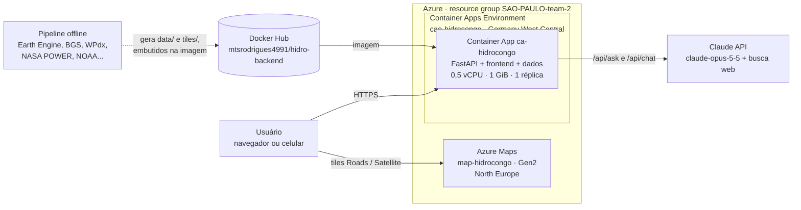
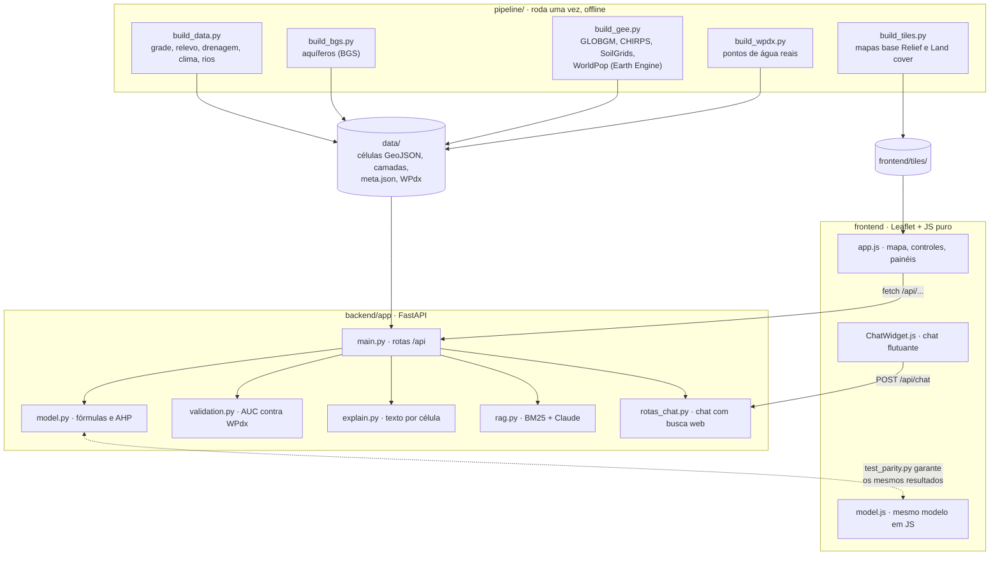

# Hidro Congo

**Poço ou rio?** Inteligência geoespacial que recomenda, para cada região da República Democrática do
Congo (RDC), a melhor forma de levar água à agricultura: perfurar um **poço tubular** ou **bombear
água de um rio**. Para cada local, o app mostra a probabilidade de sucesso do poço, a profundidade, o
custo e os fatores que pesaram na decisão.

Protótipo do time **SAO-PAULO-team-2** no Platinion Hackathon 2026.

| Acesse o app | |
|---|---|
| **https://ca-hidrocongo.bravegrass-2f493583.germanywestcentral.azurecontainerapps.io** <br><br> Aponte a câmera do celular para o QR code. <br><br> Versões para impressão: [PNG](docs/qrcode-app.png) · [SVG](docs/qrcode-app.svg) |  |

---

## 1. O problema

A RDC ocupa a maior parte da Bacia do Congo, a segunda maior bacia hidrográfica do mundo, com rios
caudalosos e aquíferos extensos. Mesmo assim, a água não chega às lavouras: a agricultura depende da
chuva (sequeiro), o que limita a produtividade e deixa as famílias vulneráveis à seca e à fome.

Quem decide onde investir em irrigação (governo, ONGs, empresas de perfuração) esbarra em três problemas:

- **Não se sabe onde há água subterrânea viável.** Um poço de 60 m custa de USD 5 mil a 17 mil
  (valores de referência do [plano](plano_arquitetura.md#36-custo-estimado-do-poço)), e um poço seco é
  dinheiro perdido.
- **A alternativa (bombear de um rio) é avaliada caso a caso**, sem comparar distância, desnível,
  vazão disponível na estação seca e custo de energia com a opção do poço.
- **Os dados existem, mas estão espalhados:** hidrogeologia (BGS), lençol freático (GLOBGM), chuva
  (CHIRPS), solo (SoilGrids), relevo (SRTM), população (WorldPop), pontos de água (WPdx). Juntá-los
  exige um especialista em SIG que a maioria das equipes no campo não tem.

## 2. A solução

O Hidro Congo junta essas fontes abertas numa **grade de células** que cobre o país (1.245 células de
~44 km, ou 4.847 de ~22 km) e calcula, para cada uma:

| Saída | Como é calculada |
|---|---|
| **Recomendação** (poço alto · poço viável · rio · inconclusivo · não recomendado) | Índice de recomendação `IR` que combina adequação do poço, adequação do rio, custo, confiabilidade climática e acesso. `IR > 0,5` → poço |
| **Probabilidade de sucesso do poço** | `GPI · (1 − WTD/WTD_max) · (R/R_ref)`, com o índice de potencial de água subterrânea (GPI) ponderado por AHP |
| **Profundidade, número de poços e custo** | Profundidade do lençol + aquífero saturado; poços necessários para a vazão demandada; capex + energia no horizonte escolhido |
| **Melhor captação no rio** | Distância, desnível, vazão ecológica (10% do rio) mês a mês e perda de carga na adutora |
| **Explicação em linguagem simples** | Texto por célula com o fator a favor e a principal limitação, e perguntas livres à IA (Claude) |

O usuário descreve o projeto (área irrigada, custo da energia, profundidade máxima, distância máxima
ao rio, horizonte de 6 meses, 1 ano ou personalizado até 5 anos) e **o mapa inteiro é recalculado na
hora**.

Toda recomendação é **preliminar**: o app aponta onde vale a pena sondar e o que esperar, mas sondagem e
teste de bombeamento continuam necessários antes da obra. Ele apoia o técnico de campo, não o substitui.

## 3. Caso de uso

**Área do hackathon:** principalmente **Grow** (agricultores sem a informação de que precisam para
produzir) e também **Reach** (acesso à água em comunidades remotas).

**Quem usa:** o técnico de extensão rural de uma ONG, de uma agência de desenvolvimento ou do ministério,
como a persona *Felix Field*, que atende centenas de pequenos produtores, e o planejador que decide
onde aplicar o orçamento de irrigação de uma província.

**Exemplo de uso:** uma ONG quer irrigar 5 ha de hortaliças para uma cooperativa em Haut-Katanga e
tem orçamento para um ano.

1. O técnico abre o app (pelo link ou pelo QR code, no celular ou no notebook) e escolhe a província.
2. Em **Irrigation project**, informa 5 ha, o horizonte de 12 meses e o custo local da energia.
3. O mapa mostra as células onde o poço é a melhor opção (verde), onde o rio compensa (azul) e onde
   nenhuma das duas é viável (vermelho).
4. Ao tocar numa célula, ele vê a probabilidade de achar água, a profundidade estimada, quantos poços são
   necessários, o custo de cada opção em 6, 12, 24 e 60 meses e o motivo da recomendação.
5. Pergunta à IA, em inglês ou na própria língua: *"Por que aqui é poço e não rio?"* ou *"Quais
   cuidados ambientais nesta área?"*. A resposta usa os números da célula e o plano técnico.
6. Leva a lista das células mais promissoras para a equipe de sondagem e evita gastar com perfuração
   onde a chance é baixa.

Outras camadas apoiam a decisão: domínios hidrogeológicos, profundidade do lençol, vazão por poço,
turfeiras da Cuvette Centrale (área ambientalmente sensível), confiança do modelo e os 7.956 pontos
de água reais do WPdx.

## 4. Modelo de negócio

> Proposta do time para levar o protótipo adiante; não é um negócio em operação.

**Clientes e o que cada um ganha:**

| Segmento | Uso | Valor |
|---|---|---|
| **Governo e ministérios** (agricultura, recursos hídricos) | Planejar programas de irrigação por província, priorizar licitações | Orçamento público aplicado onde a água é viável |
| **ONGs e agências de desenvolvimento** | Escolher locais, elaborar projetos para doadores, relatar impacto | Menos poços secos; justificativa técnica para o financiador |
| **Empresas de perfuração e irrigação** | Prospectar locais e orçar antes de mobilizar a sonda | Menos risco e menos mobilização perdida |

**Como gera receita (modelo freemium):**

1. **Mapa público gratuito**, com recomendações por província, para comunidades, governo local e
   pequenas ONGs. Mantém a ferramenta como bem público e é financiado por doadores e fundos de
   desenvolvimento.
2. **Licença institucional** (assinatura anual) para ONGs grandes, agências e ministérios: relatórios
   de viabilidade por projeto, acesso à API, inclusão de dados próprios (poços já perfurados) e
   calibração regional do modelo.
3. **Uso comercial** para empresas de perfuração e irrigação: relatório pré-sondagem por local, cobrado
   por relatório ou por pacote, a um preço muito menor que o de uma sondagem.
4. **Serviços**: calibração com dados de campo do cliente e treinamento das equipes locais.

**Custos:** a infraestrutura é pequena. O plano estima **USD 30 a 70 por mês** para o MVP e USD 260 a
550 por mês num cenário produtivo pequeno ([plano, seção 6](plano_arquitetura.md#6-custo-estimado-do-mvp-na-azure)).
Todas as fontes de dados são abertas, então não há licença de dados a pagar. O custo principal passa a
ser coletar dados de campo para validar e calibrar o modelo.

**Como medir o impacto:** perfurações secas evitadas, custo por hectare irrigado, tempo entre a ideia
do projeto e a decisão de onde perfurar, e hectares irrigados em projetos que usaram a ferramenta.

## 5. Arquitetura cloud

O que está no ar hoje, na assinatura do hackathon (resource group `SAO-PAULO-team-2`):



| Recurso | Serviço | Configuração | Função |
|---|---|---|---|
| `ca-hidrocongo` | Azure Container Apps | 0,5 vCPU, 1 GiB, 1 réplica sempre ligada, ingress HTTPS externo | Roda a API FastAPI e serve o frontend e os dados |
| `cae-hidrocongo` | Container Apps Environment | Germany West Central | Ambiente gerenciado do app |
| `map-hidrocongo` | Azure Maps | Gen2 (G2), North Europe, CORS limitado ao domínio do app | Mapas base **Roads** e **Satellite** |
| `mtsrodrigues4991/hidro-backend` | Docker Hub | Imagem `linux/amd64`, tags `v1`, `v2`, `latest` | Registro da imagem do app |
| Claude API | Anthropic | Modelo `claude-opus-5-5` | Respostas da IA no painel da célula e chat com busca web |

**Segredos:** as chaves do Azure Maps e do Claude e a credencial do Docker Hub ficam como *secrets* do
Container App (`azure-maps-key`, `anthropic-key`) e entram no container como variáveis de ambiente. Não
estão no código, na imagem nem no Git.

**Decisões para o MVP:**

- **Dados dentro da imagem.** Os dados processados ocupam ~7 MB e os mapas base pré-renderizados ~15 MB.
  Um banco não se justifica nesse tamanho: a imagem já sai pronta, sobe em segundos e não depende de
  outro serviço.
- **Pipeline fora da nuvem.** O Earth Engine e as fontes externas só são usados para gerar os dados
  (`pipeline/`). O app em produção não precisa dessas credenciais.
- **Mapas base em duas camadas.** *Relief* (SRTM) e *Land cover* (ESA WorldCover) são arquivos
  estáticos servidos pelo próprio app e funcionam sem chave. *Roads* e *Satellite* vêm do Azure Maps.
- **IA opcional.** Sem a chave do Claude, o app continua funcionando: o painel da célula responde com o
  trecho mais relevante do plano técnico (busca BM25 local), e só o chat fica desligado.
- **Região.** O app fica em Germany West Central, a região do resource group. O Azure Maps não existe
  nessa região, e West Europe não aceitava contas novas, então ele ficou em North Europe; os tiles
  servem o mundo todo de qualquer região.

**Para produção**, o [plano de arquitetura](plano_arquitetura.md#4-arquitetura-na-azure) prevê:
PostgreSQL + PostGIS para poços cadastrados e resultados, Data Lake Gen2 para rasters, Azure AI Search
para o RAG sobre documentos técnicos e legislação, Application Insights para monitoramento e uma
autenticação do Azure Maps sem chave no navegador (Entra ID ou SAS).

## 6. Arquitetura de código



| Parte | Tecnologia | Papel |
|---|---|---|
| `pipeline/` | Python, NumPy, Shapely, Pillow, Earth Engine | ETL: baixa as fontes abertas, calcula as covariáveis de cada célula e grava em `data/` |
| `backend/app/model.py` | Python puro | Modelo da seção 3 do plano: WTD, recarga, GPI com pesos AHP (CR = 0,016), `P_poço`, custos do poço e do rio (Hazen-Williams), `IR`. Duas versões: **v1** (aproximações) e **v2** (dados reais) |
| `backend/app/main.py` | FastAPI | API REST e servidor do frontend estático |
| `backend/app/rag.py`, `rotas_chat.py` | SDK `anthropic` | Perguntas sobre uma célula (RAG sobre o plano técnico) e chat com busca web e citação de fontes |
| `backend/app/validation.py` | Python | Compara as recomendações com os pontos de água reais do WPdx |
| `frontend/` | Leaflet, JavaScript puro, sem build | Mapa, controles, painéis, legenda, tema claro/escuro, chat |
| `backend/tests/` | pytest + Node | Testes da API, do chat, da validação e da paridade Python × JavaScript |

**Por que o modelo existe em Python e em JavaScript:** a API usa o de Python, e `model.js` permite
gerar uma **demo estática de arquivo único** (`pipeline/build_artifact.py` → `dist/hidro-congo.html`)
que roda no navegador **sem internet e sem servidor**. Ela serve para técnicos em áreas sem conexão. O
`test_parity.py` roda os dois sobre todas as células e garante que dão os mesmos números.

Principais rotas da API (lista completa e parâmetros em [prototipo/README.md](prototipo/README.md#endpoints)):

| Rota | Uso |
|---|---|
| `POST /api/recommendations` | Recalcula todas as células com os parâmetros do projeto |
| `POST /api/cells/{id}/evaluate` | Detalhe completo de uma célula |
| `GET /api/recommendation/point?lat=&lon=` | Recomendação por coordenada |
| `POST /api/validation` | Modelos v1 e v2 contra os pontos do WPdx |
| `POST /api/ask` · `POST /api/chat` | IA sobre uma célula · chat com busca web |

## 7. Limitações

- **O modelo ainda não está validado como discriminante.** Contra os pontos de água do WPdx, a AUC na
  área levantada fica em ~0,46: o modelo ainda não distingue bem onde há e onde não há poço registrado. A
  v2, com dados reais, corrigiu o pessimismo da v1 (poço recomendado onde existem poços: 56% → 75%).
  Para uma validação de verdade são precisos registros de perfuração com sucesso **e** fracasso.
  Detalhes em [VALIDACAO.md](prototipo/VALIDACAO.md).
- Parte das covariáveis da v1 é sintética (zonas hidrogeológicas por regra, vazões dos grandes rios por
  ordem de grandeza), marcada no app e em `data/meta.json`.
- Com resolução de 22 a 44 km, córregos pequenos não aparecem, o que tende a favorecer o poço longe dos
  rios principais.

## 8. Como rodar e publicar

```bash
cd prototipo
docker compose up --build        # http://localhost:8000
```

Novo deploy (na pasta `prototipo`, trocando `v3` pela próxima versão):

```powershell
docker build --platform linux/amd64 -f backend/Dockerfile -t mtsrodrigues4991/hidro-backend:v3 .
docker push mtsrodrigues4991/hidro-backend:v3
az containerapp update -n ca-hidrocongo -g SAO-PAULO-team-2 --image docker.io/mtsrodrigues4991/hidro-backend:v3
```

## Documentação

| Documento | Conteúdo |
|---|---|
| [prototipo/README.md](prototipo/README.md) | Como rodar, testes, regeneração dos dados, variáveis de ambiente, endpoints, decisões de modelagem |
| [plano_arquitetura.md](plano_arquitetura.md) | Plano técnico completo: fontes de dados, fórmulas, arquitetura alvo na Azure, custos, roadmap |
| [prototipo/PARAMETROS.md](prototipo/PARAMETROS.md) | O que cada controle do projeto de irrigação faz e as fórmulas por trás |
| [prototipo/VALIDACAO.md](prototipo/VALIDACAO.md) | Método e resultados da validação com o WPdx |
