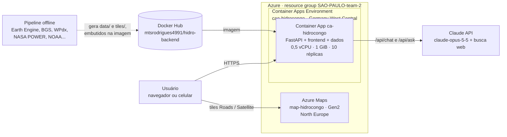
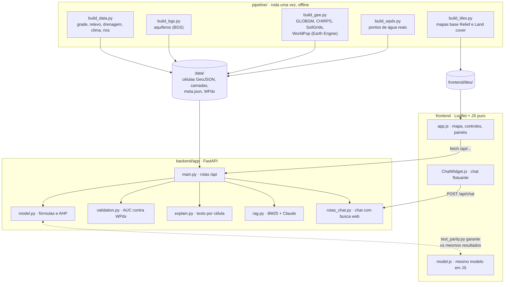

# Wherewise

*Know where before you build.*

O Wherewise calcula a probabilidade de sucesso de um investimento em cada lugar, antes que ele seja
feito. A primeira linha de produto é **Wherewise · Water DRC**; o mesmo método se aplica a outros
países e a outras decisões de localização. Os recursos de nuvem mantêm o nome do protótipo
(`hidrocongo`), e por isso a URL não mudou.

**Poço ou rio?** Inteligência geoespacial que recomenda, para cada região da República Democrática do
Congo (RDC), a melhor forma de levar água à agricultura: perfurar um **poço tubular** ou **bombear
água de um rio**. Para cada local, o app mostra a probabilidade de sucesso do poço, a profundidade, o
custo e os fatores que pesaram na decisão.

Protótipo do time **SAO-PAULO-team-2** no Platinion Hackathon 2026.

| Acesse o app | |
|---|---|
| **https://ca-hidrocongo.bravegrass-2f493583.germanywestcentral.azurecontainerapps.io** <br><br> Aponte a câmera do celular para o QR code. <br><br> Versões para impressão: [PNG](docs/qrcode-app.png) · [SVG](docs/qrcode-app.svg) |  |

---

## 1. O problema

A RDC ocupa a maior parte da Bacia do Congo, a segunda maior bacia hidrográfica do mundo, com rios
caudalosos e aquíferos extensos. Mesmo assim, a água não chega às lavouras: a agricultura depende da
chuva (sequeiro), o que limita a produtividade e deixa as famílias vulneráveis à seca e à fome.

Quem decide onde investir em irrigação (governo, ONGs, empresas de perfuração) esbarra em três problemas:

- **Não se sabe onde há água subterrânea viável.** Um poço de 60 m custa de USD 5 mil a 17 mil
  (valores de referência do [plano](plano_arquitetura.md#36-custo-estimado-do-poço)), e um poço seco é
  dinheiro perdido.
- **A alternativa (bombear de um rio) é avaliada caso a caso**, sem comparar distância, desnível,
  vazão disponível na estação seca e custo de energia com a opção do poço.
- **Os dados existem, mas estão espalhados:** hidrogeologia (BGS), lençol freático (GLOBGM), chuva
  (CHIRPS), solo (SoilGrids), relevo (SRTM), população (WorldPop), pontos de água (WPdx). Juntá-los
  exige um especialista em SIG que a maioria das equipes no campo não tem.

## 2. A solução

O Wherewise junta essas fontes abertas numa **grade de células** que cobre o país (1.245 células de
~44 km, ou 4.847 de ~22 km) e calcula, para cada uma:

| Saída | Como é calculada |
|---|---|
| **Recomendação** (poço alto · poço viável · rio · inconclusivo · não recomendado) | Índice de recomendação `IR` que combina adequação do poço, adequação do rio, custo, confiabilidade climática e acesso. `IR > 0,5` → poço |
| **Probabilidade de sucesso do poço** | `GPI · (1 − WTD/WTD_max) · (R/R_ref)`, com o índice de potencial de água subterrânea (GPI) ponderado por AHP |
| **Profundidade, número de poços e custo** | Profundidade do lençol + aquífero saturado; poços necessários para a vazão demandada; capex + energia no horizonte escolhido |
| **Melhor captação no rio** | Distância, desnível, vazão ecológica (10% do rio) mês a mês e perda de carga na adutora |
| **Explicação em linguagem simples** | Texto por célula com o fator a favor e a principal limitação, e perguntas livres à IA (Claude) |

O usuário descreve o projeto (área irrigada, custo da energia, profundidade máxima, distância máxima
ao rio, horizonte de 6 meses, 1 ano ou personalizado até 5 anos) e **o mapa inteiro é recalculado na
hora**.

Toda recomendação é **preliminar**: o app aponta onde vale a pena sondar e o que esperar, mas sondagem e
teste de bombeamento continuam necessários antes da obra. Ele apoia o técnico de campo, não o substitui.

## 3. Caso de uso

**Área do hackathon:** principalmente **Grow** (agricultores sem a informação de que precisam para
produzir) e também **Reach** (acesso à água em comunidades remotas).

**Quem usa:** o técnico de extensão rural de uma ONG, de uma agência de desenvolvimento ou do ministério,
como a persona *Felix Field*, que atende centenas de pequenos produtores, e o planejador que decide
onde aplicar o orçamento de irrigação de uma província.

**Exemplo de uso:** uma ONG quer irrigar 5 ha de hortaliças para uma cooperativa em Haut-Katanga e
tem orçamento para um ano.

1. O técnico abre o app (pelo link ou pelo QR code, no celular ou no notebook) e escolhe a província.
2. Em **Irrigation project**, informa 5 ha, o horizonte de 12 meses e o custo local da energia.
3. O mapa mostra as células onde o poço é a melhor opção (verde), onde o rio compensa (azul) e onde
   nenhuma das duas é viável (vermelho).
4. Ao tocar numa célula, ele vê a probabilidade de achar água, a profundidade estimada, quantos poços são
   necessários, o custo de cada opção em 6, 12, 24 e 60 meses e o motivo da recomendação.
5. Toca em **Ask Mbula** e pergunta à IA, em inglês ou na própria língua: *"Por que aqui é poço e não
   rio?"* ou *"Quais cuidados ambientais nesta área?"*. A Mbula consulta o mapa do Wherewise e a web, e
   responde com os números da célula.
6. Leva a lista das células mais promissoras para a equipe de sondagem e evita gastar com perfuração
   onde a chance é baixa.

Outras camadas apoiam a decisão: domínios hidrogeológicos, profundidade do lençol, vazão por poço,
turfeiras da Cuvette Centrale (área ambientalmente sensível), confiança do modelo e os 7.956 pontos
de água reais do WPdx.

## 4. Modelo de negócio

> Proposta do time para levar o protótipo adiante; não é um negócio em operação. A análise completa,
> com números do modelo, riscos e o que falta construir, está em [MODELO_NEGOCIO.md](MODELO_NEGOCIO.md).

**Somos a camada de inteligência: não perfuramos, não operamos poços e não vendemos água. Vendemos a
probabilidade de encontrar água antes da perfuração, calculada a partir de dados.** O governo paga para
errar menos ao perfurar, a empresa de água paga para saber onde instalar e onde estão os clientes, e o
agricultor recebe a informação de graça.

| Cliente | O que compra | Como cobramos |
|---|---|---|
| **Governos** e programas financiados por bancos de desenvolvimento | **Análise de probabilidade**: estudos por província, triagem de locais antes da licitação, licença da plataforma | Contrato fixo + **bônus por poço que encontra água**. O contrato também exige o resultado de cada perfuração, que calibra o modelo |
| **Empresas de perfuração e distribuição de água** | Onde instalar (água + clientes perto), logística da sonda e dos poços, lista de agricultores interessados | Assinatura, **análise por local** ou **parceria comercial**: indicamos local e demanda, o parceiro perfura, opera e cobra a água, e recebemos uma taxa por poço produtivo |
| **Agricultores** | **Ponto de água mais próximo funcionando**, relato de poço seco ou quebrado, pedido de água | Não pagam. Os relatos e pedidos viram dados e demanda, que geram receita com governo e empresas |

**O que os números do modelo mostram:**

- Uma perfuração seca de 40 m custa ~USD 4 mil. Subir a chance de sucesso de 30% para 45% evita
  ~USD 4.400 por poço produtivo. É isso que dá valor à análise vendida ao governo.
- A água de poço custa ~USD 0,14/m³ em 5 anos, contra USD 0,50 do rio (medianas do modelo v2), mas
  ainda assim ~USD 820 por hectare por ano. O agricultor pequeno só paga o custo cheio em **hortaliças
  e frutas perto de mercados**; para culturas básicas, o governo ou doadores subsidiam pagando a empresa
  por hectare irrigado.
- 22% dos poços registrados no WPdx estavam parados, e o levantamento mais recente na RDC termina em 2020.
  Saber qual poço tem água hoje é um produto, e os relatos dos agricultores mantêm esse dado vivo.

**Custos:** a infraestrutura é pequena. O plano estima **USD 30 a 70 por mês** para o MVP e USD 260 a
550 por mês num cenário produtivo pequeno ([plano, seção 6](plano_arquitetura.md#6-custo-estimado-do-mvp-na-azure)).
Todas as fontes de dados são abertas. O custo principal passa a ser coletar dados de campo.

**Como medir o impacto:** perfurações secas evitadas, custo por poço produtivo, poços funcionando 12
meses depois, hectares irrigados e quanto os agricultores pagam por m³.

## 5. Arquitetura cloud

O que está no ar hoje, na assinatura do hackathon (resource group `SAO-PAULO-team-2`):



| Recurso | Serviço | Configuração | Função |
|---|---|---|---|
| `ca-hidrocongo` | Azure Container Apps | 0,5 vCPU e 1 GiB por réplica, 10 réplicas fixas, ingress HTTPS externo | Roda a API FastAPI e serve o frontend e os dados |
| `cae-hidrocongo` | Container Apps Environment | Germany West Central | Ambiente gerenciado do app |
| `map-hidrocongo` | Azure Maps | Gen2 (G2), North Europe, CORS limitado ao domínio do app | Mapas base **Roads** e **Satellite** |
| `mtsrodrigues4991/hidro-backend` | Docker Hub | Imagem `linux/amd64`, tags `v1` a `v5` (atual) e `latest` | Registro da imagem do app |
| Claude API | Anthropic | Modelo `claude-opus-5-5` | Chat da Mbula (consulta o mapa e a web) e `/api/ask` |

**Segredos:** as chaves do Azure Maps e do Claude e a credencial do Docker Hub ficam como *secrets* do
Container App (`azure-maps-key`, `anthropic-key`) e entram no container como variáveis de ambiente. Não
estão no código, na imagem nem no Git.

**Decisões para o MVP:**

- **Dados dentro da imagem.** Os dados processados ocupam ~7 MB e os mapas base pré-renderizados ~15 MB.
  Um banco não se justifica nesse tamanho: a imagem já sai pronta, sobe em segundos e não depende de
  outro serviço.
- **Pipeline fora da nuvem.** O Earth Engine e as fontes externas só são usados para gerar os dados
  (`pipeline/`). O app em produção não precisa dessas credenciais.
- **Mapas base em duas camadas.** *Relief* (SRTM) e *Land cover* (ESA WorldCover) são arquivos
  estáticos servidos pelo próprio app e funcionam sem chave. *Roads* e *Satellite* vêm do Azure Maps.
- **IA opcional.** Sem a chave do Claude, o mapa, os cálculos e os painéis continuam funcionando; só o
  chat da Mbula fica desligado. O `/api/ask` responde com o trecho mais relevante do plano técnico
  (busca BM25 local).
- **10 réplicas fixas para a apresentação.** O app é stateless (os dados vêm da imagem e o histórico
  do chat vem do navegador), então escala só aumentando réplicas. Num teste com 30 recálculos
  simultâneos do mapa, as 30 respostas vieram OK, com tempo médio de 2,1 s.
- **Região.** O app fica em Germany West Central, a região do resource group. O Azure Maps não existe
  nessa região, e West Europe não aceitava contas novas, então ele ficou em North Europe; os tiles
  servem o mundo todo de qualquer região.

**Para produção**, o [plano de arquitetura](plano_arquitetura.md#4-arquitetura-na-azure) prevê:
PostgreSQL + PostGIS para poços cadastrados e resultados, Data Lake Gen2 para rasters, Azure AI Search
para o RAG sobre documentos técnicos e legislação, Application Insights para monitoramento e uma
autenticação do Azure Maps sem chave no navegador (Entra ID ou SAS).

## 6. Arquitetura de código



| Parte | Tecnologia | Papel |
|---|---|---|
| `pipeline/` | Python, NumPy, Shapely, Pillow, Earth Engine | ETL: baixa as fontes abertas, calcula as covariáveis de cada célula e grava em `data/` |
| `backend/app/model.py` | Python puro | Modelo da seção 3 do plano: WTD, recarga, GPI com pesos AHP (CR = 0,016), `P_poço`, custos do poço e do rio (Hazen-Williams), `IR`. Duas versões: **v1** (aproximações) e **v2** (dados reais) |
| `backend/app/main.py` | FastAPI | API REST e servidor do frontend estático |
| `backend/app/rag.py`, `rotas_chat.py` | SDK `anthropic` | Perguntas sobre uma célula (RAG sobre o plano técnico) e chat com busca web e citação de fontes |
| `backend/app/validation.py` | Python | Compara as recomendações com os pontos de água reais do WPdx |
| `frontend/` | Leaflet, JavaScript puro, sem build | Mapa, controles, painéis, legenda, tema claro/escuro, chat |
| `backend/tests/` | pytest + Node | Testes da API, do chat, da validação e da paridade Python × JavaScript |

**Por que o modelo existe em Python e em JavaScript:** a API usa o de Python, e `model.js` permite
gerar uma **demo estática de arquivo único** (`pipeline/build_artifact.py` → `dist/wherewise.html`)
que roda no navegador **sem internet e sem servidor**. Ela serve para técnicos em áreas sem conexão. O
`test_parity.py` roda os dois sobre todas as células e garante que dão os mesmos números.

As rotas da API estão na [seção 7](#7-apis).

## 7. APIs

### Rotas do projeto

A API é REST, em JSON, sem autenticação. A documentação interativa (Swagger), onde dá para testar cada
rota pelo navegador, fica em
**[/docs](https://ca-hidrocongo.bravegrass-2f493583.germanywestcentral.azurecontainerapps.io/docs)**.

As rotas de células aceitam `?res=0.4` (padrão, 1.245 células de ~44 km) ou `?res=0.2` (4.847 células
de ~22 km). As rotas `POST` recebem `{"params": {...}}` com os parâmetros do projeto; os que faltarem
usam o padrão, que aparece em `/api/meta`.

| Método e rota | O que devolve | Usada pela interface |
|---|---|---|
| `GET /api/health` | Status, número de células e se a IA está ligada (`"rag": "claude"`) ou não (`"extrativo"`) | Sim |
| `GET /api/meta` | Parâmetros padrão, pesos do AHP, grades disponíveis, fontes de dados e a chave do Azure Maps | Sim |
| `GET /api/cells` | Células em GeoJSON com as covariáveis (relevo, chuva mês a mês, aquífero, rio mais próximo, população). Dado bruto, sem recomendação | Sim |
| `GET /api/layers/{nome}` | Camadas de apoio: `departments` (26 províncias), `rivers` (38), `cities` (88), `stations` (22 estações de chuva), `waterpoints` (7.956 pontos do WPdx) | Sim |
| `POST /api/recommendations` | **Rota principal.** Recomendação de todas as células e resumo por província. Com `"detail": true`, devolve todos os campos do cálculo | Sim |
| `POST /api/cells/{id}/evaluate` | Uma célula com todos os componentes do cálculo, custos do poço e do rio e a explicação em texto | Sim |
| `POST /api/validation` | Modelos v1 e v2 comparados com os poços reais do WPdx (AUC, % de acerto, poços funcionando por faixa de probabilidade) | Sim |
| `POST /api/ask` | Resposta do Claude sobre o plano técnico e, se vier `cell_id`, sobre aquela célula, com os trechos usados | Não (integração; a interface pergunta pela Mbula) |
| `POST /api/chat` | Chat da Mbula: Claude com busca na web, devolvendo a resposta e as fontes | Sim |
| `GET /api/recommendation/point?lat=&lon=` | Recomendação para a célula mais próxima de uma coordenada. Fora da RDC devolve 404 | Não (integração) |
| `GET /api/regions/{província}` | Resumo e células de uma província (ex.: `Kinshasa`, `Haut-Katanga`) | Não (integração) |
| `GET /api/explain/{id}` | Só o texto explicativo de uma célula | Não (integração) |

As três rotas `GET` de integração aceitam apenas `horizon_months`, `start_month`, `area_ha` e `res`,
e **sempre usam o modelo v1**. Para o modelo v2, use as rotas `POST` com `"model_version": 2`.

### Exemplos

```bash
U=https://ca-hidrocongo.bravegrass-2f493583.germanywestcentral.azurecontainerapps.io

# recomendação para uma coordenada (Kinshasa)
curl "$U/api/recommendation/point?lat=-4.32&lon=15.31"

# mapa inteiro para um projeto de 10 ha, 24 meses, modelo v2
curl -X POST "$U/api/recommendations" -H "Content-Type: application/json" \
  -d '{"params": {"area_ha": 10, "horizon_months": 24, "model_version": 2}}'

# detalhe de uma célula
curl -X POST "$U/api/cells/506/evaluate" -H "Content-Type: application/json" \
  -d '{"params": {"model_version": 2}}'

# pergunta à IA sobre uma célula
curl -X POST "$U/api/ask" -H "Content-Type: application/json" \
  -d '{"question": "Why is a borehole recommended here?", "cell_id": 506}'

# chat com busca web
curl -X POST "$U/api/chat" -H "Content-Type: application/json" \
  -d '{"message": "What does the DRC water law say about irrigation permits?", "history": []}'
```

No PowerShell, use `Invoke-RestMethod`:

```powershell
Invoke-RestMethod "$U/api/recommendations" -Method Post -ContentType "application/json" `
  -Body '{"params":{"area_ha":10,"horizon_months":24,"model_version":2}}'
```

Parâmetros do projeto mais usados: `model_version` (1 ou 2), `horizon_months` (1 a 60), `start_month`
(1 a 12), `area_ha`, `c_energia` (USD/kWh), `WTD_max` (profundidade máxima viável, m), `D_max_km`
(distância máxima ao rio) e os pesos do índice `w1` a `w5`. A lista completa está em
[prototipo/README.md](prototipo/README.md#endpoints) e o efeito de cada um em
[PARAMETROS.md](prototipo/PARAMETROS.md).

### Como ler a resposta

| Campo | O que quer dizer |
|---|---|
| `IR` (0 a 1) | Comparação **relativa** entre poço e rio. Acima de 0,5 o poço é melhor **que o rio**, o que não quer dizer que seja bom |
| `P_poco` (0 a 1) | Chance estimada de o poço encontrar água: o número **absoluto** |
| `cls` | Cor do mapa: `poco_alto` (poço com `P_poco` ≥ 45%), `poco_viavel` (poço com chance menor), `rio`, `inconclusivo` (`IR` entre 0,47 e 0,53), `nao_recomendado` (poço e rio com adequação abaixo de 0,12) |
| `rec` | Só a escolha: `poco` ou `rio` |
| `WTD`, `H`, `n_pocos` | Profundidade do lençol, profundidade de perfuração (m) e poços necessários para a área |
| `C_poco_total`, `rio.C_total` | Investimento + energia no horizonte escolhido (USD), para o projeto inteiro |
| `fator_pos`, `fator_neg` | O fator que mais ajudou e o que mais atrapalhou a opção recomendada |
| `confianca` | Cresce perto de estações de chuva medida e quando o `IR` está longe de 0,5. Não mede a qualidade do dado hidrogeológico |

Exemplo do motivo de separar `IR` e `P_poco`: a célula 10 (Haut-Katanga) tem `IR` = 0,65 e é
classificada como poço viável, mas com só 19% de chance de sucesso. O poço ganha porque o rio mais
próximo está a 15 km e 82 m acima, então é a opção menos ruim.

O resultado também muda bastante entre os modelos. Na célula 506 (Kinshasa), o v1 estima 31% de
chance, lençol a 36 m e USD 36 mil; o v2 estima 67%, lençol a 2,5 m e USD 11 mil. A interface abre no v1.

### APIs externas

| API | Quem chama | Para quê |
|---|---|---|
| **Azure Maps Render** (`atlas.microsoft.com/map/tile`) | O navegador | Tiles dos mapas base Roads e Satellite |
| **Claude** (Anthropic, `claude-opus-5-5`) | O backend | `/api/ask` e `/api/chat` |
| **Busca web do Claude** (ferramenta do lado do servidor) | O Claude, dentro do `/api/chat` | Pesquisa na web com fontes. O código também aceita o Bing Web Search, mas a Microsoft encerrou essa API em agosto de 2025 |
| Earth Engine, BGS, WPdx, NASA POWER, NOAA GHCN, AWS Terrain Tiles | Só o `pipeline/`, offline | Gerar os dados de `data/` e `frontend/tiles/`. O app no ar não chama nenhuma delas |

### Cuidados

- **Sem autenticação nem limite de uso.** Qualquer pessoa com o link pode chamar `/api/ask` e
  `/api/chat`, e cada chamada consome a chave do Claude.
- **A chave do Azure Maps é pública:** ela vai para o navegador por `/api/meta`. O CORS da conta está
  limitado ao domínio do app.

## 8. Limitações

- **O modelo ainda não está validado como discriminante.** Contra os pontos de água do WPdx, a AUC na
  área levantada fica em ~0,46: o modelo ainda não distingue bem onde há e onde não há poço registrado. A
  v2, com dados reais, corrigiu o pessimismo da v1 (poço recomendado onde existem poços: 56% → 75%).
  Para uma validação de verdade são precisos registros de perfuração com sucesso **e** fracasso.
  Detalhes em [VALIDACAO.md](prototipo/VALIDACAO.md).
- Parte das covariáveis da v1 é sintética (zonas hidrogeológicas por regra, vazões dos grandes rios por
  ordem de grandeza), marcada no app e em `data/meta.json`.
- Com resolução de 22 a 44 km, córregos pequenos não aparecem, o que tende a favorecer o poço longe dos
  rios principais.

## 9. Como rodar e publicar

```bash
cd prototipo
docker compose up --build        # http://localhost:8000
```

Novo deploy (na pasta `prototipo`, trocando `v6` pela próxima versão):

```powershell
docker build --platform linux/amd64 -f backend/Dockerfile -t mtsrodrigues4991/hidro-backend:v6 .
docker push mtsrodrigues4991/hidro-backend:v6
az containerapp update -n ca-hidrocongo -g SAO-PAULO-team-2 --image docker.io/mtsrodrigues4991/hidro-backend:v6
```

## Documentação

| Documento | Conteúdo |
|---|---|
| [prototipo/README.md](prototipo/README.md) | Como rodar, testes, regeneração dos dados, variáveis de ambiente, endpoints, decisões de modelagem |
| [MODELO_NEGOCIO.md](MODELO_NEGOCIO.md) | Monetização com governos, empresas de água e agricultores: números do modelo, receita, riscos, o que falta construir e piloto |
| [plano_arquitetura.md](plano_arquitetura.md) | Plano técnico completo: fontes de dados, fórmulas, arquitetura alvo na Azure, custos, roadmap |
| [prototipo/PARAMETROS.md](prototipo/PARAMETROS.md) | O que cada controle do projeto de irrigação faz e as fórmulas por trás |
| [prototipo/VALIDACAO.md](prototipo/VALIDACAO.md) | Método e resultados da validação com o WPdx |
